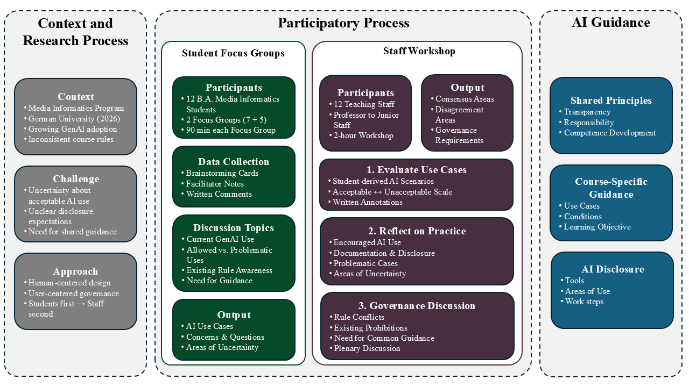
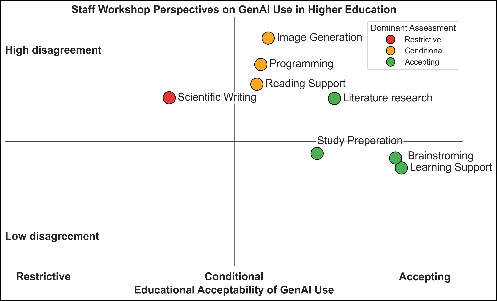

# "It depends on the course": Co-Designing Context-Sensitive Guidelines for Generative AI Use in Informatics Education

<hr>

**Niklas Donhauser¹* · Michael Achmann-Denkler¹ · Markus Weinberger¹* · Christian Wolff¹*

¹University of Regensburg - Media Informatics Group, Regensburg, Germany  

*✉ Correspondence to: [Niklas Donhauser](mailto:Niklas.Donhauser@ur.de)*  
`{mail}@mail`
</div>

<hr>

## Abstract

The adoption of Generative Artificial Intelligence (GenAI) in higher education requires instructors to determine which use cases support learning and which undermine intended competencies. 
Although universities typically provide general guidelines, translating them into context-sensitive and actionable guidance remains challenging. 
This paper presents a case study of participatory GenAI governance in a university Media Informatics program. 
We combined two student focus groups (n=12) with a workshop involving teaching staff (n=12) across hierarchical levels. 
Student discussions identified recurring use cases and uncertainties, which instructors subsequently evaluated.
Findings revealed substantial differences in perceived acceptability and disagreement among instructors, particularly where AI use could replace intended learning processes. 
Rather than producing uniform rules, the process resulted in a layered approach combining shared principles, course-specific decisions, and standardized disclosure of AI use.
We implemented these findings as a configurable guidance infrastructure that connects acceptable AI use to the competencies educational activities are intended to develop.

*Keywords: generative AI; higher education; informatics education; AI governance; academic integrity; participatory design; AI literacy*

## Results

Overview of the participatory process.


Staff workshop positioning map.


## Repository structure

```text
.
├── LICENSE
├── README.md
├── 01_students_focus_groups/
├── 02_staff_workshop/
├── 03_code/
├── 04_images/
├── 05_misc/
└── ...
```

This repository contains the project documentation, workshop materials, analysis scripts, and generated figures used for the study.

## Citation

Accepted at "3rd International conference on digital skills, IT professionalism and informatics education"

TBA
